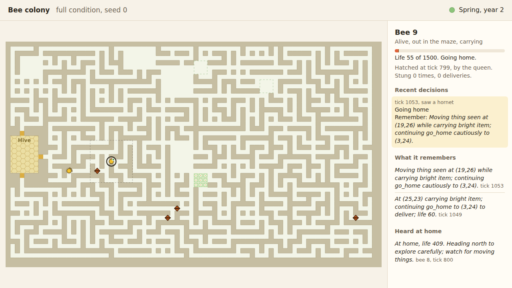

# Bee colony (working title)

A colony of language-model bees that has to work out, from nothing, where the flowers are, what keeps hurting it, and how to tell its young, while the hornets evolve to hunt it.

<!-- Judges read this first. Every claim below points at an experiment in EXPERIMENTS.md or a run in experiments/results/. -->

## The idea

A maze, 80 by 48 cells. On the left edge is the hive. Far away on the right are three patches of bloom, one for spring, one for summer, one for autumn, in the same places every year. In winter nothing blooms and a bee caught outside burns life twice as fast.

Each bee is a small mind running on Claude Haiku 5.5. It is never told it is a bee. It is told only that its life is a number that falls each moment and ends at zero, that something worth finding exists in this place, and that it is one of many identical members of a home. It sees 4 cells around it, notices bright cells from 6, hears two sounds called `sound-1` and `sound-2`, and keeps its own memories. It can talk, but only inside the hive.

A bee that carries bloom home doubles its life, and, if the colony has room, a new bee hatches with no memories at all. So whatever one bee learns dies with it, unless it says it at home before it goes.

Hornets roam the maze. They are not AI. Each carries 10 points spread over three genes (smell, hearing, ambush), and every 25 ticks the least successful hornet is replaced by a mutated copy of a successful one. A sting takes half a bee's life. The bees are never told what a hornet is: a sting reaches the model as "lost half your life in an instant", with no cause named. A test checks that the words bee, hive, flower, bloom, hornet, danger, season, food, good, bad and nine others never appear in any prompt.

So everything the colony comes to know (where the bloom is, that moving things hurt, which way to go in spring) it has to find out itself, and keep alive by talking.

## Why digital life?

The property we go deep on is **adaptation, at three speeds**, under seasonal change:

| Speed | Mechanism | Ablation that removes it |
|---|---|---|
| Within one life | each bee's episodes, notes and recall | `no_memory` |
| Across bee generations | hive talk: the only way knowledge can outlive the bee that found it | `no_talk` |
| Across hornet generations | selection and mutation of hornet genomes | `frozen_hornets` |

Persistence (knowledge outliving every bee that gained it), interaction (talk, sounds, predator and prey) and emergence (whether two meaningless sounds come to mean something; `labels_good_bad` is its control) are studied as parts of that one question, not as separate features. Each speed has its own switch, so each claim can be tested by turning it off.

## Demonstration

Video to come. A still from the viewer, replaying a recorded run of the `full` condition (seed 0, tick 1053). Bee 9 set out in winter, found the spring bloom the moment it opened, and is carrying it home past hornets with 55 life left; the panel shows its own notes and what it heard at home ([EXPERIMENTS.md](EXPERIMENTS.md), E3):



Run a small version yourself, no key needed:

```bash
make demo
```

It runs scripted bees in a small world for one short year (3 seeds), then replays a full 2-year AI run from the main experiments (`full`, seed 0: 1,440 model decisions) offline from its saved model responses, and checks every output file is identical to the original. About 10 seconds in all; the last line should read `REPLAY IDENTICAL`. The viewer (`viewer/`) turns any run directory into one HTML page you can open from disk: `.venv/bin/python viewer/bundle.py <seed dir> -o run.html`.

## Technical architecture

```
   seed -> World (maze, hive, bloom, calendar)
             |
   tick loop (src/digital_life/sim.py), one tick at a time:
     senses (bees.py)       what each bee perceives, from its own position only
     mind (mind.py)         one Claude Haiku 5.5 call per deciding bee, in parallel
       render.py            perception -> neutral text; reply -> decision (structured output)
       memory.py            each bee's episodes, notes, recall (BM25)
     motor (motor.py)       intent -> one step, by A* over the bee's own map
     hornets (hornets.py)   smell, hear, ambush, sting, evolve
             |
   run directory: layout.json, state.jsonl.gz, events.jsonl, metrics.jsonl, record.json
             |                      |                         |
   viewer/ replays it    experiments/analysis/ measures it   llm.py's replay cache reproduces it
```

Full detail, with the design choices and the alternatives rejected, in [ARCHITECTURE.md](ARCHITECTURE.md).

## How it works

- **Decisions.** A bee decides every 5 ticks, and at once when it is stung, newly sees a moving thing, sees bloom, hears a sound, arrives, gets home, or its life crosses half or a quarter. A decision is an intent (`explore` a direction, `go_to` x, y, `go_home`, `flee`, `wait`), a sound or none (each costs 1 life, and hornets can hear it), a note to remember, and up to 30 words to say at home.
- **Body.** A motor layer with no AI walks the intent: A* over the cells this bee has seen, unknown cells assumed open, replanning when a wall appears. The mind chooses where to go, not each step.
- **Memory.** Every bee keeps episodes scored by importance (a sting or a delivery 5, bloom 4, a moving thing 3, talk heard 2, a sound 1), up to 12 notes it chose to write, and recall of the 6 best episodes by recency, importance and text relevance. Memory dies with the bee.
- **Culture.** Words said at home reach every bee at home that tick and are stored as things heard. That is the only channel between bees.
- **Evolution.** Hornet fitness is life removed per tick alive. Steady-state selection every 25 ticks outside winter; after winter, spring's hornets are bred from the fittest of autumn.
- **Reproducibility.** Every model call goes through `src/digital_life/llm.py`, which records request and response. A seed fixes the maze, the bloom and the first hornets; the cache fixes the minds. Replay is exact, file for file.

## Getting started

Requires Python 3.11 or later and `make`. No GPU, no API key for anything below.

```bash
git clone <public repository URL, at submission>
cd digital-life
make setup        # .venv, pinned dependencies, secret-scan pre-commit hook
make test         # 62 tests, about a minute
make demo         # small scripted world, then an offline replay of a recorded AI run
```

Reproduce the main results offline, from the recorded model responses:

```bash
make replay RUN=experiments/results/full/20261106T101558Z/seed-0   # re-runs a 2-year AI run, checks every file
make analysis     # every pre-registered measure and figure, into experiments/analysis/output/
```

Each replay takes 5 to 9 seconds and ends with `REPLAY IDENTICAL`; all 19 AI runs were checked this way ([EXPERIMENTS.md](EXPERIMENTS.md), "Replay and reproducibility"). `make analysis` rewrites `experiments/analysis/output/main_results.md`, the source of every number below, and five PNG figures.

Run a new experiment live (needs `ANTHROPIC_API_KEY` in `.env`, see `.env.example`):

```bash
.venv/bin/python experiments/run.py experiments/configurations/full.toml --seeds 5
```

A 2-year AI run took 11 to 18 minutes and cost about $0.28 in our runs (19 runs, $5.37 in all, at list price for Claude Haiku 5.5). Scripted runs take a few seconds. Known limitations are listed at the end of [EXPERIMENTS.md](EXPERIMENTS.md).

## Experiments and findings

We pre-registered four hypotheses, the measures and the decision rule before the first real bee-mind call (commit c2052a2), then ran 29 two-year runs at one commit: five AI arms and two scripted baselines, 3 or 5 seeds each, paired by seed. 26,093 AI decisions, no model failures. Every number below is copied from [experiments/analysis/output/main_results.md](experiments/analysis/output/main_results.md); the full write-up, with controls, is [EXPERIMENTS.md](EXPERIMENTS.md).

**All four hypotheses failed their controls.** We report that plainly, because the controls are what tell us what the colony is really doing.

| | Hypothesis | What happened |
|---|---|---|
| E1 | Memory and talk make the colony a better gatherer | No. 1.8 deliveries per 2 years for `full` (sd 1.643, n 5), the same as rule bees (1.8, sd 1.483, n 5); removing talk or memory did not lower it |
| E2 | Hornets evolve to exploit the colony | No. Stings per trip rose in year 2 (by 0.315, sd 0.516, n 5), but also with frozen hornets (0.158) and scripted bees (0.192), with no consistent difference: the genes drift |
| E3 | The colony finds spring bloom sooner in year 2, because talk keeps the knowledge alive | No. No bee in `full` or `no_talk` lived through both springs, and the one early year-2 delivery came from a bee that never heard the place |
| E4 | Two meaningless sounds come to mean something | Could not happen: bees made 3 sounds in 6,610 decisions |

What the controls showed instead:

- **The AI bees are careful, not clever.** They made 36.4 trips per run against the rule bees' 61.2 and were stung less per trip on all three pre-registered paired seeds (0.516 against 0.586 over 5 seeds), yet gathered no more.
- **Their caution is the model's prior, not learning.** At the first sight of a moving thing, before ever being stung, bees fled or went home 0.857 of the time in `full` (n 5), and 1.000 of the time with no memory at all (n 3), against 0.110 to 0.282 at routine decisions. Nobody told them moving things hurt; nobody had to.
- **Words make meaning; the world did not.** With the sounds named "good noise" and "bad noise", bees used them at once and in the words' sense: 8 "good noise" calls at home, 7 of them right after a delivery, and one "bad noise" the moment a bee was stung. The neutral sounds stayed silent. Any meaning a sound has here comes from its label, which is the prompt effect this control was built to catch.
- **They invent the idea of harm.** No prompt contains danger, avoid, careful or harm, yet 0.219 of what `full` bees said at home used one of those words (sd 0.130, n 5): "Bright cells near (41,29) still dangerous", from a bee stung twice at that bloom. Bees without talk used them in their notes as often, so each bee reaches the idea alone.
- **Hive talk is grounded.** Of 1,621 coordinates said at home in `full`, 33 point at neither home, a bloom, nor a place where the speaker had seen a moving thing.
- **A surprise: winter foragers.** All four first deliveries of a second spring in the AI runs came from bees that left home in the middle of winter, which the bees are never told exists, and were out in the maze when the bloom opened.

**Reproducible to the byte.** All 19 AI runs replay offline from the committed responses, with identical output files ([EXPERIMENTS.md](EXPERIMENTS.md), "Replay and reproducibility").

Figures: [deliveries per season](experiments/analysis/output/fig_deliveries_by_season.png), [stings per trip](experiments/analysis/output/fig_stings_per_trip.png), [first spring delivery, year 1 against year 2](experiments/analysis/output/fig_first_spring_delivery.png), [hornet genes over time](experiments/analysis/output/fig_hornet_genes.png), [sounds and context](experiments/analysis/output/fig_sound_context.png).

## AI usage

All of the code was written by Claude Code (Claude Opus 5.5); the core game mechanics and every accepted design decision are Jacob Schoenberg's. At runtime the bee minds are Claude Haiku 5.5. Details, item by item: [AI_DISCLOSURE.md](AI_DISCLOSURE.md).

## Agent traces

The project was built in headless Claude Code sessions, one per phase (world and calibration, viewer, AI mind and pre-registration, main runs and analysis), each launched from a setup session where Jacob and the agent wrote the spec. Every session started in this repository was exported automatically from its original log into [agent_traces/](agent_traces/); see [agent_traces/README.md](agent_traces/README.md) for what was kept, what was redacted and why, and what is missing (including a phase 1 session that died on a timeout), and [agent_traces/INDEX.md](agent_traces/INDEX.md) for the session list with models, token usage and commits.

## Team

Jacob Schoenberg, solo entry. Jacob designed the core mechanics (maze, life as steps, a distant goal that brings life and offspring, life-draining threats drawn to the strongest bees, knowledge shared only at home, half-life stings with one heal, seasons, two sounds, the colony cap), set the constraints, and approved the spec and the design proposals marked as accepted in [DECISIONS.md](DECISIONS.md). Claude Code wrote the code and the documents, and proposed the rest of the design; who decided what is in DECISIONS.md and [AI_DISCLOSURE.md](AI_DISCLOSURE.md).

## Future directions

With another month:

- **Ten seeds per arm, not three.** The world is noisy by design, and with n = 3 only large, consistent differences can be told from chance. Every number in EXPERIMENTS.md says how many seeds it rests on.
- **A free-sound arm.** Sounds cost 1 life and attract hornets, and bees almost never make them. A pre-registered arm with free sounds would tell "no meaning emerges" apart from "sounds are too expensive to try".
- **Follow knowledge through the colony.** Trace each coordinate from the bee that saw it, through every retelling at home, to the bee that acts on it, and measure how far and how long true and false claims travel.
- **The prompt-robustness arm** the spec lists as a stretch: a paraphrased and reordered system prompt with the same facts, to show that what the colony does comes from the world, not from the wording.
- **Bigger colonies.** Colonies spend much of their time near the 2-bee floor, so few bees are at home to hear anything. A world with more bloom would give culture more carriers.
- **Walls that block sight**, and hornets that remember places within a life as well as evolving across lives, so both sides of the arms race can learn at two speeds.

## Licence

MIT. See [LICENSE](LICENSE).
